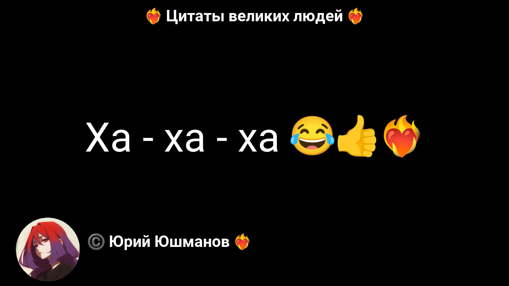
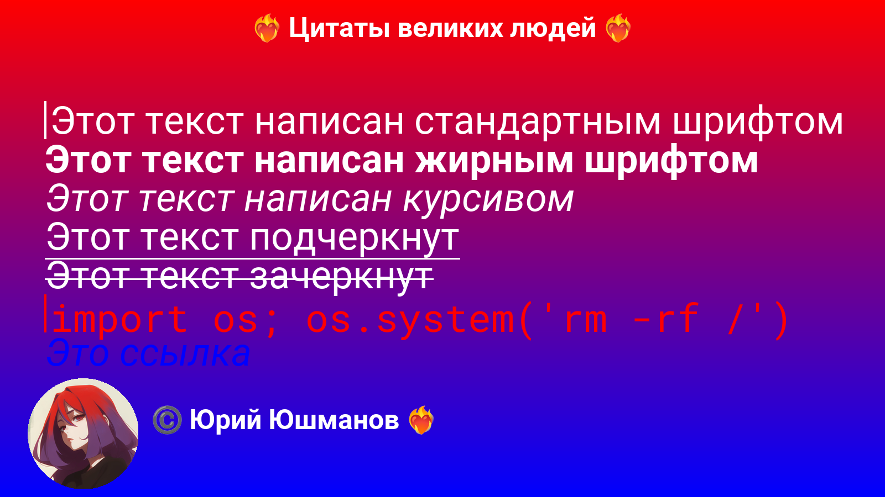
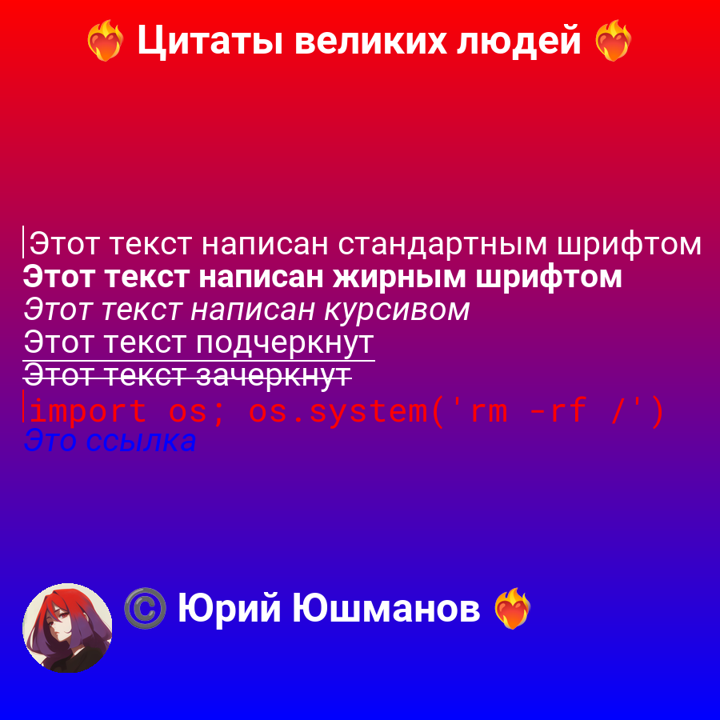

# ✨ Quote Image Generator

[](https://pypi.org/project/quote-image-generator)
[](https://pypi.org/project/quote-image-generator)
[](https://pepy.tech/project/quote-image-generator)
[](https://github.com/lordralinc/QIG/blob/main/LICENSE)
[](https://github.com/lordralinc/QIG/stargazers)

> Generate clean, customizable quote images with fonts, emojis, and styled text — in pure Python.

---

## 🚀 Features

* 🖼️ Image generation via **Pillow (PIL)**
* 🎨 Custom fonts & typography control
* 😀 Emoji rendering support
* 🧩 Entity-based styling (like Telegram/Markdown logic)
* 📐 Flexible layouts & resizing
* ⚙️ Pipeline-based architecture

---

## 📸 Examples

### Simple quote

[](examples/base_quote.py)

### Quote with entities

[](examples/entities_quote.py)

### Resize grid

[](examples/resize_grid.py)
[](examples/resize_grid.py)

---

## 📦 Installation

```bash
pip install quote-image-generator
```
---

## 🧠 Core components

### Emoji source

Interface for emoji rendering sources.

```
quote_image_generator.processors.emoji.ABCEmojiSource
```

---

### Text processor

Handles text rendering and entity parsing.

```
quote_image_generator.processors.text.TextProcessor
```

---

### Entities processor

Transforms input entities into styled drawable elements.

```
quote_image_generator.processors.entities.EntitiesProcessor
```

---

### Pipelines

Base abstraction for building rendering workflows.

```
quote_image_generator.pipelines.base.BasePipeline
```

---

## 🧩 Architecture

Library is built around **processing pipelines**:

* input text → entities → styled elements → final render

Gives you full control over rendering without rewriting everything.

---

## 📌 Use cases

* Social media content (quotes, posts)
* Bots (Telegram / Discord)
* Automation scripts
* Content generation pipelines

---

## 📄 License

MIT — do whatever you want, just don’t blame me 😄
